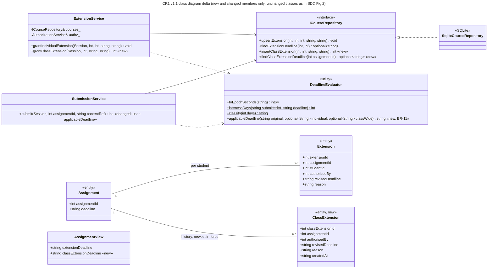
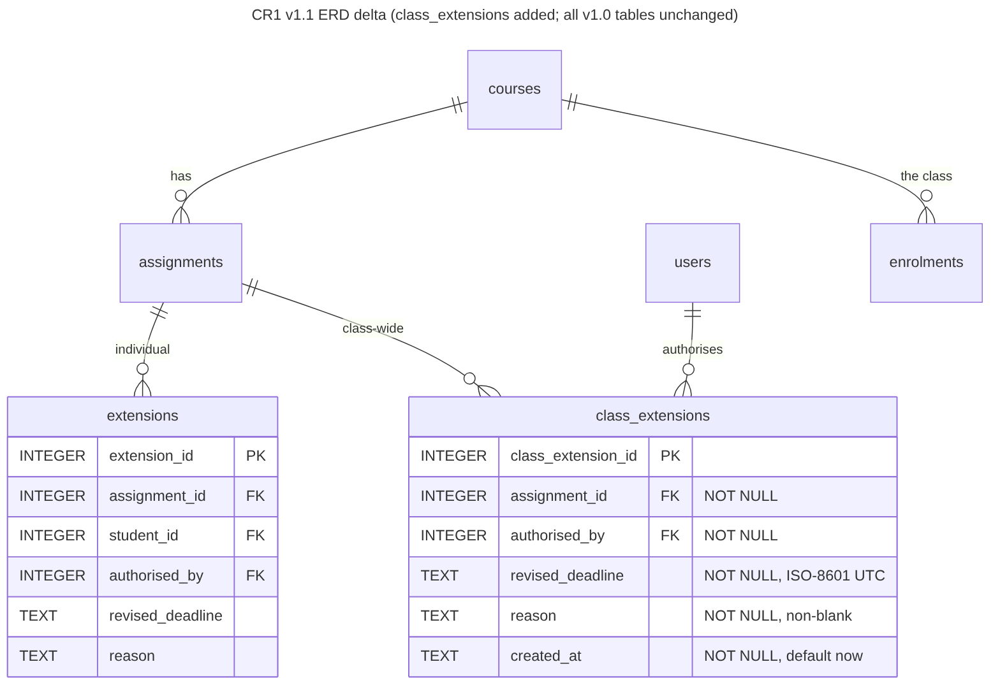
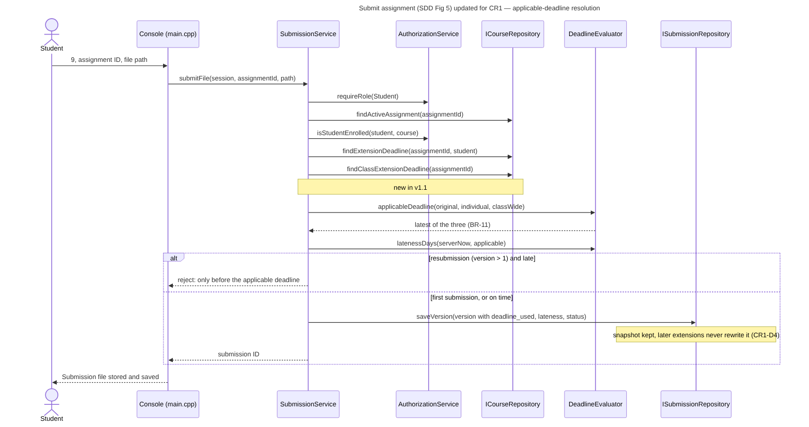

# CR1 — Design document updates for v1.1

This document records the changes to the Phase 3 Software Design Document (SDD) made by change request CR1. Figures not listed here are unchanged (justification in `CR1_IMPACT_ANALYSIS.md` §4). The diagrams below are delta views drawn from the code as implemented. **Action for the report:** copy each change into the original draw.io figures (Fig 2, 4, 5, 7) so the final report shows one consistent v1.1 design.

## 1. Class diagram (SDD Fig 2): delta

| Element | Change | SOLID note |
|---|---|---|
| `ExtensionService::grantClassExtension(Session, assignmentId, revisedDeadline, reason) : int` | New operation | SRP: extension rules stay in the extension service. |
| `DeadlineEvaluator::applicableDeadline(original, individual?, classWide?) : string` (static) | New pure function implementing BR-11 | SRP and Open/Closed: the precedence rule lives in exactly one place; a different approved rule changes only this function and its tests. |
| `SubmissionService::submit` | Calls `applicableDeadline` instead of "individual or original" | Behaviour change confined to one line; v1.0 behaviour is the special case with no class extension. |
| `ICourseRepository::insertClassExtension`, `findClassExtensionDeadline` | New interface operations | Dependency Inversion is preserved: services still see only the interface. Interface Segregation trade-off: they were added to the existing course/extension repository rather than a new `IExtensionRepository`, because individual extensions already live there. Splitting both out is a sensible later refactor. |
| `ClassExtension` | New entity (append-only) | — |
| `AssignmentView::classExtensionDeadline` | New read-model field | — |

## 2. ERD (SDD Fig 7) and data dictionary

### Data dictionary entry: `class_extensions` (new in v1.1)

| Column | Type | Key / constraint | Meaning |
|---|---|---|---|
| `class_extension_id` | INTEGER | PK | Surrogate key; also gives the order of changes (the newest row is in force). |
| `assignment_id` | INTEGER | FK → `assignments`, NOT NULL, ON DELETE RESTRICT | Assignment whose deadline is extended for the whole class. |
| `authorised_by` | INTEGER | FK → `users`, NOT NULL | Lecturer who granted it; must be assigned to the course (enforced in `ExtensionService`). |
| `revised_deadline` | TEXT | NOT NULL; ISO-8601 UTC `YYYY-MM-DDTHH:MM:SSZ` (validated in the service) | New deadline for every enrolled student. |
| `reason` | TEXT | NOT NULL, non-blank (CHECK) | Why the class was given more time. |
| `created_at` | TEXT | NOT NULL, default now (UTC, ms) | When the extension was granted or changed. |

Index `ix_class_extensions_assignment (assignment_id, class_extension_id)` supports "newest row for an assignment".

**Normalisation.** Every non-key attribute depends on the whole key (`class_extension_id`) and on nothing else, so the table is in 3NF (and BCNF). The class is **not** stored: it is derived at use time from `enrolments` through `assignments.course_id`. Storing a list of students, or one row per student, would duplicate `enrolments` and create an update anomaly: a late enroller would be missed (CR1-D1). The "current" extension is also derived (newest row) rather than stored as a flag, which avoids two rows both claiming to be current.

**Class ↔ table mapping.** `ClassExtension` ↔ `class_extensions` (one-to-one, same attribute names in camelCase). No other mapping changes.

## 3. Sequence diagram "Submit assignment" (SDD Fig 5): updated

New steps: `findClassExtensionDeadline` and `applicableDeadline`. The late and resubmission branches are unchanged, and the stored `deadline_used` snapshot is what keeps later extensions from rewriting history (CR1-D4).

## 4. Activity diagram (SDD Fig 4): text change

In the Lecturer swimlane, the action "Grant individual extension" becomes **"Grant extension (individual student or whole class)"**, followed by a decision node `[class-wide] → record class extension (new deadline must be later than the current one)` / `[individual] → record individual extension`. Both flows join before "Student submits". No other swimlane changes.

## 5. Use case model

The *Grant extension* use case (Lecturer) gains an alternative flow **A-CLASS**: (1) the lecturer selects an assignment in a course they teach; (2) enters a revised deadline for the whole class and a reason; (3) the system checks that the deadline is later than the original and than any class extension in force; (4) the system records the extension, and every enrolled student's assignment list shows `class extension <deadline>`. Exception flows: not the assigned lecturer → access denied; deadline not later → rejected with a message; blank reason → rejected. UC-01 *Submit assignment* step 4 ("displays the applicable deadline") now applies BR-11.

## 6. New and changed requirements (SRS v1.1)

- **FR-23 (Must):** A lecturer shall grant a class-wide extension (revised deadline and reason) for an assignment in a course they are assigned to. It applies to every student enrolled in that course, and every change is recorded with the authorising lecturer and time.
- **BR-11 (provisional, CR1-D2/D3):** Applicable deadline = latest of the original deadline, the class-wide extension in force and the student's individual extension. A class-wide extension may only move the deadline later.
- **FR-21 (Should, extended):** the assignment list shows any class-wide extension as well as the student's own individual extension.
- **BR-10:** retired (delivered in v1.1).
